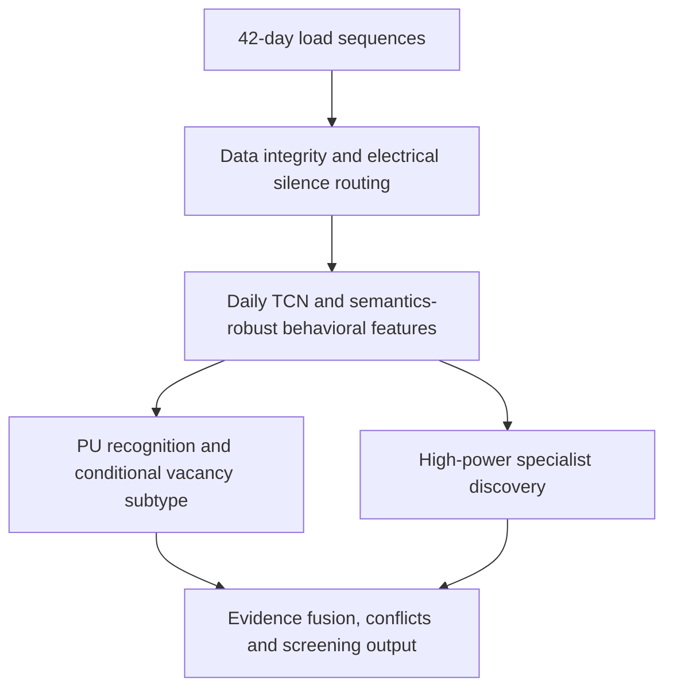

# Vacant Home Detection

[中文](README.md) | **English**

Vacant-home recognition from long-horizon residential load behavior. The project analyzes 42-day power sequences using self-supervised temporal representations, interpretable behavioral features and positive-unlabeled learning to find vacancy candidates, explain their behavior and prioritize business verification.

## Business problem

Vacant homes may consume no power or retain a persistent equipment load. Automatic systems can sustain high power without occupants, while inhabited homes can maintain low consumption. Power magnitude alone cannot reliably separate vacancy from residential use.

The analysis focuses on long-term behavior: sustained human interaction across multiple times of day, persistent equipment backgrounds, sparse returns and changes in use. Relevant cases include:

- Complete silence and near-zero load.
- Low-power or high-power equipment-maintained patterns.
- Automatic backgrounds with occasional interaction.
- Intermittent returns, weekend use and state changes.
- Low-power rich activity, high-power active use and ambiguous mixed behavior.

High power does not establish occupancy; low power does not establish vacancy. Regularity does not prove automatic operation, and irregularity does not prove human interaction.

## Recognition workflow



Invalid data is routed separately. Valid all-zero sequences provide strong electrical-silence evidence, with meter and supply verification still relevant. Nonzero users enter behavioral recognition, which examines persistent automatic backgrounds and sustained human interaction.

## Core methods

### Self-supervised daily representation

A dual-branch dilated TCN learns behavior shape and magnitude separately. Masked reconstruction, amplitude consistency and magnitude prediction use unlabeled daily curves while preserving clock-time structure. Daily representations are combined with cross-day, weekly and change-point features to characterize long-term behavior.

### Robust features and PU recognition

Feature fusion includes power quantiles, zero/near-zero sample fractions, cross-day shape similarity, background recurrence, consecutive sample runs, state transitions, interaction complexity, sparse episodes and weekend patterns. Bagging PU with histogram gradient boosting (HGB) learns from historical expert-confirmed vacancy positives and unlabeled users. Unlabeled users are not treated as confirmed active homes.

Inputs are periodic frozen active-power samples recorded every 15 minutes. The main method does not rely on fixed daily-energy thresholds or interpret unverified power integration as real energy.

### Conditional subtype and automatic/human axes

The subtype model answers which pattern is most compatible conditional on vacancy: complete, equipment-maintained, equipment-intermittent or intermittent use.

Automatic-control compatibility and human-interaction evidence are computed separately, allowing automatic backgrounds and human activity to coexist. Weekend tendency remains a separate tag, rather than a fifth mutually exclusive vacancy type.

### High-power discovery

A specialist branch addresses the blind spot caused by historical positives concentrated at low power. Within comparable-power populations, it combines three evidence families: absence of sustained human interaction, automatic/background structure and learned representation. Equipment-maintained and equipment-intermittent scale-normalized similarities are evaluated separately, with window, seed and amplitude-scaling stability checks.

High power determines eligibility for specialist analysis, not evidence of vacancy or occupancy. Main-model global thresholds remain unchanged.

### Conflict and abstention

Strong vacancy and activity evidence can coexist. The system marks this conflict explicitly and retains uncertain cases when evidence is insufficient, models disagree or results are unstable.

## Business outputs and value

Cohort-wide outputs include high vacancy suspicion, moderate vacancy suspicion, likely active use, uncertain and invalid data. High-power vacancy screening candidates receive an additional specialist flag.

Per-user evidence ranks, conditional subtype support, automatic/human axes, weekend tendency, stability, disagreement and reasons support screening, boundary analysis and efficient review prioritization. Evidence scores are screening measures, not vacancy probabilities calibrated against verified human labels.

## Project structure

```text
vacant-home-detection/
├── README.md                    Project overview
├── README.en.md
├── pyproject.toml               Package configuration and dependencies
├── src/vacant_home/
│   ├── cli.py                   Command-line entry point
│   ├── data.py                  Data loading and sample isolation
│   ├── representation.py        Daily TCN and long-horizon representation
│   ├── models.py                Feature fusion and PU recognition
│   ├── validation.py            Evaluation, stability and business routing
│   ├── inference.py             Model inference
│   ├── reporting.py             Result reports and case plots
│   ├── peer_audit.py            Region/hardware matched-peer audit
│   ├── runtime.py               Runtime workspace configuration
│   └── high_power/              Specialist discovery and amplitude audit
├── docs/                        Methodology, model card and reproducibility
│   ├── zh/
│   └── en/
├── tests/                       Unit tests
├── scripts/                     Source verification utilities
└── .github/workflows/           Automated tests
```

## Method documentation

- [Methodology](docs/en/methodology.md)
- [Model card](docs/en/model_card.md)
- [Research references](docs/en/research_notes.md)
- [Data contract](docs/en/data_contract.md)
- [Usage and reproducibility](docs/en/reproducibility.md)
