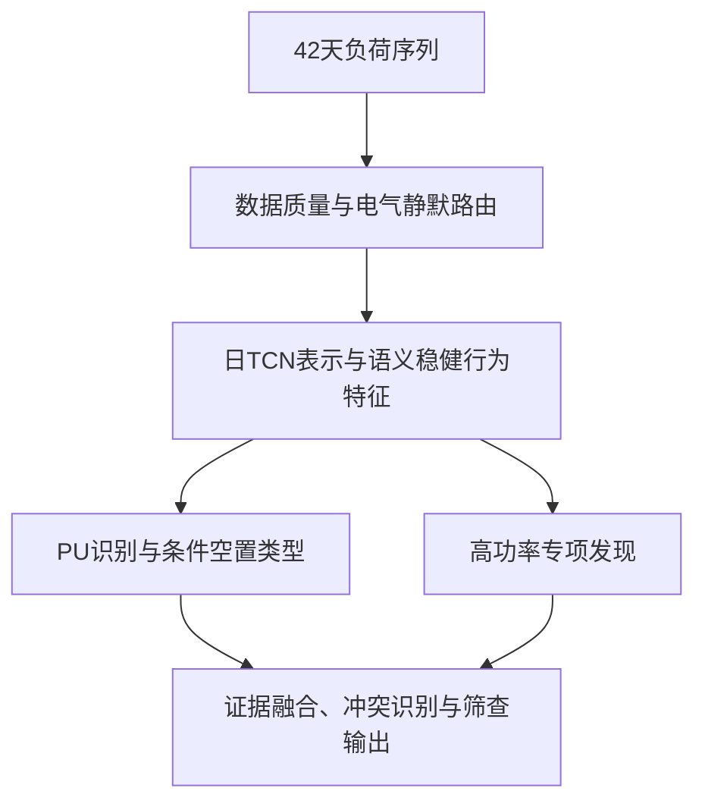

# 空置房识别

**中文** | [English](README.en.md)

基于居民长期负荷行为的空置房识别与筛查。通过分析42天用电序列，结合自监督时序表示、可解释行为特征和正样本—未标记学习，发现疑似空置用户，解释其行为类型，并为业务核验提供依据。

## 要解决的业务问题

空置房可能完全不耗电，也可能长期保留设备负荷。自动控制设备在无人环境下仍可持续高功率运行；真实居住用户也可能长期低功率用电。因此，功率大小本身无法可靠区分空置与居住。

项目关注的是长期行为：是否存在持续、多时段的人为交互，是否主要表现为稳定设备背景，是否出现少量返访或阶段性使用。识别覆盖：

- 完全空置与近零负荷；
- 低功率或高功率设备维持；
- 设备背景叠加少量间歇使用；
- 间歇返回、周末使用和状态切换；
- 低功率丰富活动、高功率正常使用及难以判断的混合行为。

高功率不等于有人，低功率不等于空置；规律不等于自动设备，不规律不等于人为活动。

## 识别流程



数据无效用户单独路由；有效全零序列提供强电气静默证据，同时保留表计与供电状态核验要求。非零用户进入行为识别，重点区分持续自动背景与持续人为交互。

## 核心方法

### 自监督日时序表示

采用双分支膨胀卷积TCN，分别学习行为形态和功率尺度。遮挡重建、幅值一致性与功率尺度预测任务充分利用未标记日曲线，同时保留日内时钟结构。日表示与跨日、周周期和阶段变化特征共同描述长期行为。

### 语义稳健特征与PU识别

融合功率分位、零/近零样本占比、跨日形态相似度、背景复现、样本连续段、状态转移、交互复杂度、稀疏episode和周末模式。主识别头采用Bagging PU与直方图梯度提升树（HGB），利用历史人工确认空置样本与未标记用户进行学习，未标记用户不被认定为正常真值。

输入按“15分钟周期冻结有功功率样本”处理，主方法不依赖固定日电量阈值，也不将未经确认的功率积分当作真实电量。

### 空置类型与自动／人为双轴

条件类型模型回答“如果属于空置，更像哪类”：完全空置、设备维持、设备维持-间歇或间歇使用。

自动控制兼容度与人为交互证据分别计算，允许自动背景与人为活动同时存在。周末使用倾向作为独立标签，不增加第五种互斥空置类别。

### 高功率专项发现

针对历史正样本偏向低功率造成的识别盲区，在相近功率人群中联合分析人为交互缺失、自动背景结构和学习表示三个证据族。分别比较设备维持与设备维持-间歇的尺度归一化行为相似度，并检查跨窗口、种子和幅值缩放的稳定性。

高功率只决定专项分析资格，不作为空置或居住证据；专项不降低主模型全局阈值。

### 冲突与拒判

同时出现较强空置证据和活动证据时，显式标记冲突。证据不足、模型分歧较大或结果不稳定时保留“暂无法可靠判断”，避免用单一功率规则强行分类。

## 业务输出与价值

全量输出高疑似空置、中等疑似空置、高疑似正常使用、暂无法可靠判断和数据无效，并单独标记高功率疑似空置专项候选。

每户提供证据分与排名、条件类型支持、自动／人为双轴、周末倾向、稳定性、模型分歧和主要原因，支持筛查排序、异常边界分析与有限人工核验的优先级安排。证据分用于筛查，不表示经人工真值校准的空置概率。

## 项目结构

```text
vacant-home-detection/
├── README.md                    项目概述
├── README.en.md
├── pyproject.toml               包配置与依赖
├── src/vacant_home/
│   ├── cli.py                   命令行入口
│   ├── data.py                  数据加载与样本隔离
│   ├── representation.py        日TCN与长期时序表示
│   ├── models.py                特征融合与PU识别
│   ├── validation.py            模型评价、稳定性与业务路由
│   ├── inference.py             模型推理
│   ├── reporting.py             结果报告与案例图
│   ├── peer_audit.py            同区域、同硬件匹配审计
│   ├── runtime.py               运行工作区配置
│   └── high_power/              高功率专项发现与幅值审计
├── docs/                        方法说明、模型卡与复现指南
│   ├── zh/
│   └── en/
├── tests/                       单元测试
├── scripts/                     源文件校验工具
└── .github/workflows/           自动化测试
```

## 方法文档

- [方法说明](docs/zh/methodology.md)
- [模型卡](docs/zh/model_card.md)
- [研究参考](docs/zh/research_notes.md)
- [数据接口](docs/zh/data_contract.md)
- [运行与复现](docs/zh/reproducibility.md)

